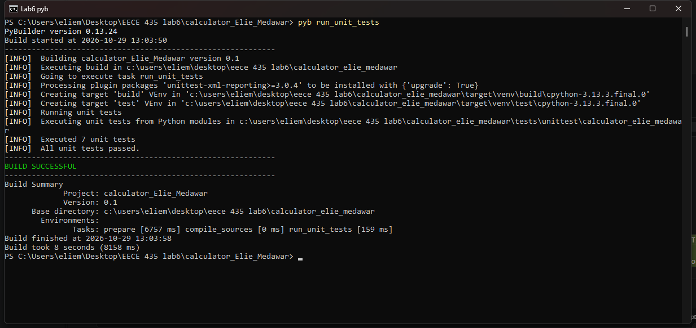
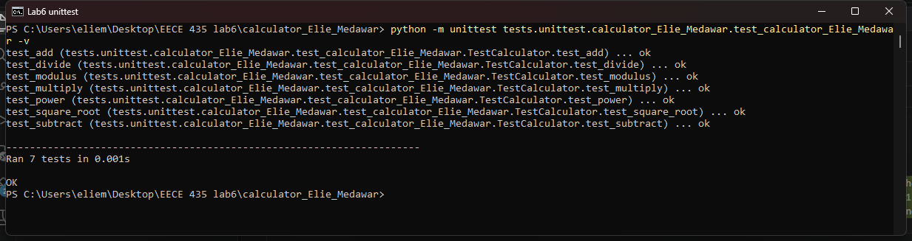

# calculator_Elie_Medawar

EECE 435 Lab 6: Automatic build using PyBuilder.

A simple calculator package with `add`, `subtract`, `multiply`, `divide`, plus the graded extensions `modulus`, `power` and `square_root`, each covered by unit tests.

## Build

```
pip install pybuilder
pyb run_unit_tests
```

Or run the tests directly:

```
python -m unittest tests.unittest.calculator_Elie_Medawar.test_calculator_Elie_Medawar
```

## Build output




